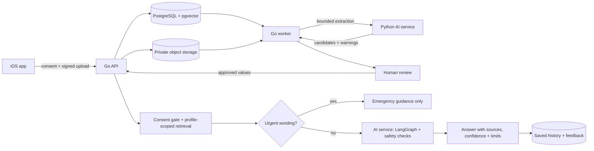

  

Illustrative interface preview · not a screenshot of a released app

> **Prototype:** CORTEX is a local-development project, not a production medical product. It does not diagnose or prescribe, and its development authentication is not suitable for shared or production deployments.

## Designed around your records

| Capability | What it does |
|---|---|
| **Organize** | Keep health reports together in a profile-scoped record. |
| **Review** | Inspect and edit report-derived values before approving them. |
| **Understand** | Ask questions using approved records and retrieved research sources. |
| **Stay in control** | Manage data permissions; keep original reports in private object storage. |

### The report-to-record flow

  

Text version of the same flow:

The Go service is the authorization and data-access boundary. Python receives only operation-specific inputs and does not access the health database directly. Extracted values stay candidates until a person reviews and approves them.

## Features in this build

### iOS app

- SwiftUI profile setup and local API connection.
- Separate permissions for report storage and document processing.
- PDF, JPEG, and PNG uploads through short-lived signed URLs.
- Report list, preview, candidate editing, and explicit approval.
- Approved health-value list and question interface with confidence badges, suggested follow-ups, emergency banner, past questions, and helpful/not-helpful feedback.
- Session token stored in Keychain; uploaded files are SHA-256 hashed.

### API and data services

- Go + Chi API for profiles, consent, documents, observations, and audit events.
- PostgreSQL with transactional migrations and profile/owner-scoped records.
- Background document and research processing with persisted state and retries.
- Private S3-compatible storage, upload verification, and expiring download links.
- Saved question history (list, rate, delete) included in data export and removed with the profile.
- Hybrid record retrieval using PostgreSQL full-text search and pgvector.
- Read-only MCP tools with short-lived profile-scoped HMAC tokens.
- OpenAPI contract, request IDs, bounded requests, and health/readiness endpoints.

### AI and research

- FastAPI service with LangGraph workflows for Medical Records, Lab Intelligence, and Health Research.
- Conservative text-based report extraction; scanned-document OCR is not wired up.
- 384-dimensional embeddings with a deterministic fallback or pinned Hugging Face model; optional reranking.
- Emergency and self-harm wording is triaged before any retrieval or model call; answers carry a confidence level and uncertainty note.
- Profile-scoped record retrieval and curated research retrieval with source metadata and limitations.
- Optional local explanation generation with safety checks; recorded facts remain separate from generated explanations.
- Allowlisted lookups for public sources such as MedlinePlus, LOINC, UCUM, and PubMed. New knowledge remains pending until administrator review.

## Architecture

| Layer | Technology | Responsibility |
|---|---|---|
| Client | Swift, SwiftUI | Consent, reports, review, approved values, questions |
| API | Go, Chi | Identity boundary, authorization, consent, health data |
| Worker | Go | Queued document processing, retries, research tasks |
| AI service | Python, FastAPI, LangGraph | Extraction, bounded workflows, embeddings, retrieval |
| Database | PostgreSQL, pgvector | Health records, audit data, vector and full-text search |
| File store | S3-compatible storage; SeaweedFS locally | Private originals and signed access |
| Local stack | Docker Compose | API, worker, AI service, database, object storage |

## Privacy and current limits

- Owner/profile authorization and consent checks are enforced by the API.
- Original reports stay in private object storage. External research lookups use public terms, not uploaded report text.
- Extracted values require human approval before they become health observations.
- Local development authentication must be replaced with a verified identity provider before any shared deployment.
- HealthKit/device sync, camera analysis, medical imaging, and scanned-document OCR are not implemented.
- CORTEX is an educational prototype and does not provide diagnosis or treatment advice.

## Run locally

**Requirements:** Docker Compose, Go 1.22+, Python 3.11+, and Xcode 15+ for the iOS app.

1. Generate local secrets: `scripts/bootstrap-env`
2. Start the services: `docker compose up --build`
3. Check `http://localhost:8080/healthz` and `http://localhost:8080/readyz`.
4. Open [`ios/CortexApp.xcodeproj`](./ios/CortexApp.xcodeproj) in Xcode and run the `CortexApp` scheme in a simulator.
5. Connect to `http://localhost:8080` using the development token from `.env`.
6. Create a profile, grant report-storage and processing consent, upload a text-based PDF, review its candidates, and ask a question.

For a physical iOS device, set `S3_PUBLIC_ENDPOINT` to an address reachable from the device. Do not expose the development stack as a production service.

## Project structure

- [`backend/`](./backend/) — Go API, worker, OpenAPI contract, and migrations.
- [`cortex-ai/`](./cortex-ai/) — FastAPI service, workflows, retrieval, safety checks, and tests.
- [`ios/`](./ios/) — SwiftUI iOS client.
- [`e2e/`](./e2e/) — end-to-end tests against the Docker stack.
- [`docs/assets/cortex-workflow.svg`](./docs/assets/cortex-workflow.svg) — animated technical workflow.
- [`.github/workflows/`](./.github/workflows/) — parallel CI (Go matrix, Python, Docker builds, integration, iOS build) and nightly regression.
- [`infra/`](./infra/) — local database initialization.
- [`architecture/full-architecture.md`](./architecture/full-architecture.md) — system architecture, boundaries, and roadmap.
- [`architecture/milestones.md`](./architecture/milestones.md) — end-to-end milestone checklist and current status.
- [`architecture/requirements.md`](./architecture/requirements.md) — the 12 product areas, with honest status.
- [`architecture/technical-architecture.md`](./architecture/technical-architecture.md) — technical architecture, UX system and tech stack.
- [`architecture/decisions.md`](./architecture/decisions.md) — implementation boundary and design decisions.

Python tests: `cd cortex-ai && python -m pytest`

## Planned, not shipped

Scanned-document OCR, HealthKit and device integrations, camera/vision features, medical imaging, and production identity need separate consent, provenance, evaluation, and security work before they can be considered product capabilities.
