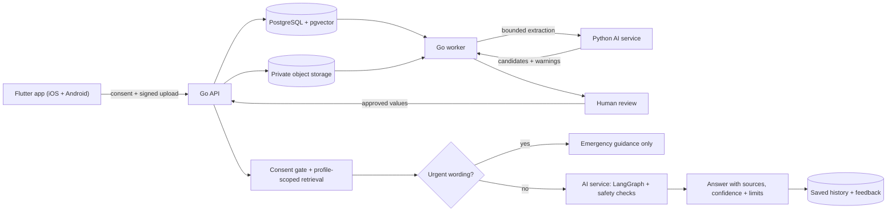

# Sehat (CORTEX) — your personal health record, explained

Sehat helps people keep their own medical records in one place and understand them. You upload lab reports and prescriptions, review what was read from them, and then ask questions in plain language. Every answer cites your records or a named source, and says how sure it is.

It is built for patients and families, with India in mind: one profile per family member and plain-language explanations. It explains and organizes. It does not diagnose, prescribe or change doses.

> **Prototype:** Sehat is a local-development project, not a production medical product. It does not diagnose or prescribe, and its development authentication is not suitable for shared or production deployments.

## What you can do

- **Keep everything together:** scan or upload reports, review the extracted values with the evidence beside them, then approve.
- **See your health over time:** biomarker trends against reference ranges, vitals, phone health data, lifestyle and symptom patterns.
- **Understand your medicines:** save prescriptions, see a daily dose schedule, and look up what a medicine is for.
- **Ask and get sourced answers:** the AI assistant answers from your approved records and retrieved research, with confidence and limits stated.
- **Prepare for the doctor:** a care plan, visit prep and a plain-language summary you can export as a PDF.
- **Stay in control:** consent per purpose, audit history, data export and delete, private storage for original files.

## Designed around your records

| Capability | What it does |
|---|---|
| **Organize** | Keep health reports together in a profile-scoped record. |
| **Review** | Inspect and edit report-derived values before approving them. |
| **Understand** | Ask questions using approved records and retrieved research sources. |
| **Stay in control** | Manage data permissions; keep original reports in private object storage. |

### Architecture, modules 01–22

Status per module lives in [`modules/README.md`](./modules/README.md).

The Go service is the authorization and data-access boundary. Python receives only operation-specific inputs and does not access the health database directly. Extracted values stay candidates until a person reviews and approves them.

## Features in this build

### Flutter app (iOS + Android)

- `app/` is one Flutter codebase for iPhone and Android, covering the 46-screen design in `design/screens.html`.
- Real Google / Apple sign-in, Face ID / biometric app lock, skeleton loading and an offline banner.
- Today, Vault (scan or upload, review with evidence, approve), Health (biomarkers, Vitals, phone health data), Ask AI with cited answers, Lifestyle with patterns (correlation, not cause), care plan, visit prep and summary (PDF export), Privacy centre.
- Agent tab: starter questions built from your own record (flagged labs, latest result, active symptom), not fixed text.
- Prescriptions: save a prescription, see each medicine's daily schedule and log doses.
- Nearby care and alerts using GPS (approximate by default; precise only for directions and sharing, never sent to Sehat), emergency contacts and offline Medical ID.
- Air and weather, and medicine look-up screens.
- Run it with `cd app && flutter pub get && flutter run` on a connected phone; test with `flutter analyze && flutter test`.

### API and data services

- Go + Chi API for profiles, consent, documents, observations, and audit events.
- PostgreSQL with transactional migrations and profile/owner-scoped records.
- Background document and research processing with persisted state and retries.
- Private S3-compatible storage, upload verification, and expiring download links.
- Saved question history (list, rate, delete) included in data export and removed with the profile.
- Hybrid record retrieval using PostgreSQL full-text search and pgvector.
- Read-only MCP tools with short-lived profile-scoped HMAC tokens.
- OpenAPI contract, request IDs, bounded requests, and health/readiness endpoints.

### Live data and third-party sources

| Source | Used for | Notes |
|---|---|---|
| WHO, Overpass (OSM) | Nearby alerts, hospitals and pharmacies | Public, no key |
| Open-Meteo | Air quality and weather | Public, no key |
| OpenAQ | Nearest air-quality station | Needs `CORTEX_OPENAQ_API_KEY` |
| RxNorm (RxNav), openFDA | Medicine search and label text | US catalogue, not an Indian brand list; answers say so |
| PubMed, Europe PMC, ClinicalTrials.gov | Research agent | Proposals wait for admin approval |

Wearables (Oura, Withings, Google Health), ABDM and FHIR need developer credentials and onboarding and are not connected yet.

### AI and research

- FastAPI service with LangGraph workflows for Medical Records, Lab Intelligence, and Health Research.
- Conservative text-based report extraction; scanned-document OCR is not wired up.
- 384-dimensional embeddings with a deterministic fallback or pinned Hugging Face model; optional reranking.
- Emergency and self-harm wording is triaged before any retrieval or model call; answers carry a confidence level and uncertainty note.
- Profile-scoped record retrieval and curated research retrieval with source metadata and limitations.
- Optional local explanation generation with safety checks; recorded facts remain separate from generated explanations.
- Optional agent mode using the GitHub Copilot SDK (`CORTEX_COPILOT_GITHUB_TOKEN`, `CORTEX_COPILOT_MODEL`) or a local Ollama model (`CORTEX_OLLAMA_URL`, `CORTEX_OLLAMA_MODEL`). The Copilot agent can only call read-only record tools.
- Allowlisted lookups for public sources such as MedlinePlus, LOINC, UCUM, and PubMed. New knowledge remains pending until administrator review.

## Architecture

| Layer | Technology | Responsibility |
|---|---|---|
| Client | Flutter, Dart, Riverpod | iOS and Android app: consent, reports, review, values, questions, nearby care |
| API | Go, Chi | Identity boundary, authorization, consent, health data |
| Worker | Go | Queued document processing, retries, research tasks |
| AI service | Python, FastAPI, LangGraph | Extraction, bounded workflows, embeddings, retrieval |
| Database | PostgreSQL, pgvector | Health records, audit data, vector and full-text search |
| File store | S3-compatible storage; SeaweedFS locally | Private originals and signed access |
| Local stack | Docker Compose | API, worker, AI service, database, object storage |

## Privacy and current limits

- Owner/profile authorization and consent checks are enforced by the API.
- Original reports stay in private object storage. External research lookups use public terms, not uploaded report text.
- Extracted values require human approval before they become health observations.
- Local development authentication must be replaced with a verified identity provider before any shared deployment.
- Wearable sync, camera analysis, medical imaging, ABDM and FHIR are not connected yet.
- Sehat is an educational prototype and does not provide diagnosis or treatment advice.

## Run locally

**Requirements:** Docker Compose, Go 1.22+, Python 3.11+, and Flutter 3.x (with Xcode for iPhone or the Android SDK for Android).

1. Generate local secrets: `scripts/bootstrap-env`
2. Start the services: `docker compose up --build`
3. Check `http://localhost:8080/healthz` and `http://localhost:8080/readyz`.
4. Run the app: `cd app && flutter run` on a connected phone.
5. Set `CORTEX_GOOGLE_CLIENT_IDS` / `CORTEX_APPLE_CLIENT_IDS` in `.env`, then sign in with Google or Apple (see `backend/README.md`, Authentication).
6. Create a profile, grant report-storage and processing consent, upload a text-based PDF, review its candidates, and ask a question.

For a physical phone, set `S3_PUBLIC_ENDPOINT` to an address reachable from the device. Do not expose the development stack as a production service.

## Project structure

- [`backend/`](./backend/) — Go API, worker, OpenAPI contract, and migrations.
- [`cortex-ai/`](./cortex-ai/) — FastAPI service, workflows, retrieval, safety checks, and tests.
- [`app/`](./app/) — Flutter client for iOS and Android.
- [`design/screens.html`](./design/screens.html) — the 46-screen design.
- [`e2e/`](./e2e/) — end-to-end tests against the Docker stack.
- [`docs/assets/cortex-workflow.svg`](./docs/assets/cortex-workflow.svg) — animated technical workflow.
- [`.github/workflows/`](./.github/workflows/) — parallel CI (Go matrix, Python, Docker builds, Flutter analyze and tests, end-to-end) and nightly regression.
- [`infra/`](./infra/) — local database initialization.
- [`architecture/full-architecture.md`](./architecture/full-architecture.md) — system architecture, boundaries, and roadmap.
- [`architecture/milestones.md`](./architecture/milestones.md) — end-to-end milestone checklist and current status.
- [`architecture/requirements.md`](./architecture/requirements.md) — the 12 product areas, with honest status.
- [`architecture/technical-architecture.md`](./architecture/technical-architecture.md) — technical architecture, UX system and tech stack.
- [`architecture/decisions.md`](./architecture/decisions.md) — implementation boundary and design decisions.

Python tests: `cd cortex-ai && python -m pytest`

## Contributing and support

Contributions are welcome. Read [`CONTRIBUTING.md`](./CONTRIBUTING.md) for local checks and pull request guidance. Use GitHub Issues for reproducible bugs and feature proposals; do not include real health information, credentials, or private documents. See [`SECURITY.md`](./SECURITY.md) for reporting security concerns privately.

## Roadmap (designed, not built)

These are design proposals. None of them is implemented yet; the mockups are not in the repository.

- **Condition threads:** group labs, reports, prescriptions, symptoms and follow-ups under one condition (existing or new), with user-confirmed links. Allergies, vaccinations and family history stay person-level.
- **360 dashboard:** one Health-tab view with trends, range bars, a body map, dose adherence, lifestyle and insights that link to the records behind them.
- **Visual explainers:** what each organ and test does, why a doctor orders it, and how each medicine works, in English and Hindi, with reviewed content.
- **Analytics and forecasts:** Python trend forecasts of a person's own results with a range and sample size, shown only when there is enough data. No diagnosis prediction.
- **Evidence-based answers:** live lookups to public sources with citations, a groundedness check on generated text, and a small reviewed set of Indian guidance. No large local corpus.
- **Model options:** Copilot first with a small open-model fallback (for example MedGemma 4B on CPU), subject to licence and terms checks.

Task breakdown: [`architecture/flutter-technical-tasks.md`](./architecture/flutter-technical-tasks.md).

## Planned, not shipped

Scanned-document OCR, HealthKit and device integrations, camera/vision features, medical imaging, and production identity need separate consent, provenance, evaluation, and security work before they can be considered product capabilities.
