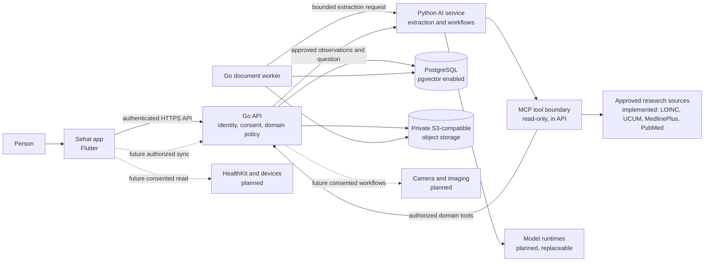
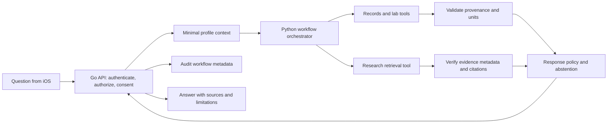

# CORTEX full architecture

## Status and scope

This document describes both the working foundation in this repository and the proposed target architecture. A component marked **Implemented** is present in the current vertical slice. **Planned** describes an architectural direction, not a shipped capability. Model families and runtimes are candidates until they pass the selection and evaluation process below.

CORTEX is a research-capable personal health platform. It is not designed as an autonomous diagnostic system. Its core responsibility is to help a person organize their own health information, review extracted data, and understand that data alongside traceable research.

## Architectural goals

- Keep identity, profile ownership, consent, and durable health data under explicit backend control.
- Separate product APIs and data access from AI inference and orchestration.
- Make AI workflows bounded, inspectable, reproducible, and able to abstain.
- Preserve provenance from uploaded records and external evidence through to responses.
- Require human review before extracted values become approved health observations.
- Allow model and integration changes without changing the iOS client or core domain model.
- Build the secure data foundation first; add agent and research capabilities incrementally.

## System context



The diagram includes intended extension points. The Go API serves read-only MCP endpoints and profile-scoped retrieval; the AI service supports embeddings, configurable model integrations and public research fetchers. Camera analysis, external wearable connectors and medical imaging are not established production integrations.

## Major components and boundaries

| Component | Responsibility | Current status |
|---|---|---|
| Flutter application | Profile selection, consent, report review, trends and assistant UI. | **Implemented** mobile client; not a claim of production validation. |
| Go API | Own authentication, profile ownership checks, consent, document workflows and data access. | **Implemented**; Google and Apple identity and local development configuration exist. |
| Go worker | Process document and research jobs and persist state. | **Implemented** as a separate service with a durable outbox and retries. |
| Python AI service | Provide extraction, retrieval and question workflows. | **Implemented** as FastAPI; configured model availability varies by deployment. |
| Agent orchestration | Bound workflows, collect evidence and compose responses. | **Partial**: LangGraph workflows and a Copilot SDK agent exist; clinical validation remains open. |
| MCP clients and servers | Expose narrowly scoped tools and resources. | **Partial**: read-only, scoped API tools exist; MCP is not a job queue. |
| Model registry and runtimes | Track model versions and route inference. | **Partial**: configuration supports multiple runtimes; deployment and evaluation are separate work. |
| PostgreSQL | Store profiles, consents, document metadata, extracted observations, and audit events. Add durable workflow and retrieval records as those capabilities are built. | **Implemented** with `pgvector` enabled. |
| Private object storage | Store original reports and other private binary assets; expose them only through authorized API paths. | **Implemented** with SeaweedFS (S3-compatible) for local development. |
| External research and device integrations | Retrieve public evidence or consented measurements through bounded adapters. | **Partial**: research fetchers and device data APIs exist; vendor integrations need separate onboarding. |
| Observability | Correlate API, worker, AI, tool, model, and research activity without leaking health content into logs. | **Planned**; structured application logs exist in the Go service. |

### Service ownership

- **Go is the policy and data-access boundary.** It authenticates the caller, authorizes profile-scoped operations, checks consent, and owns writes to the health record.
- **Python is an execution boundary, not a second system of record.** It receives only the data needed for a specific operation and returns candidates, evidence, and workflow results.
- **PostgreSQL is the durable source of truth.** Redis may be introduced for caching or ephemeral coordination only when justified; it must not become the source of truth for health data or durable jobs.
- **Object storage holds binary content.** The database stores object keys and metadata, not public object URLs.
- **The client is untrusted.** Client-side consent UX is not a replacement for server-side authorization and consent enforcement.

## Technology direction

| Layer | Direction | Notes |
|---|---|---|
| Client | Flutter and Dart | Health integrations need separate permissions and must preserve source and measurement metadata. |
| Core API | Go + Chi | Profile-scoped business APIs, authorization, consent, audit, and durable data access. |
| AI API and workflows | Python + FastAPI and LangGraph | Keep workflow definitions explicit and versioned. Do not introduce autonomous agent-to-agent loops. |
| Tool protocol | MCP | Use for bounded tool/resource discovery and invocation, not persistence or background scheduling. |
| Model ecosystem | Hugging Face Hub, Transformers, Sentence Transformers | The Hub is a discovery and artifact ecosystem, not an inference runtime or clinical validation. |
| Inference | Transformers, vLLM, or Ollama candidates | Select a runtime per deployment and hardware profile; keep the application behind a model adapter. |
| Retrieval | PostgreSQL + pgvector; BGE/E5 embedding candidates; cross-encoder reranker candidate | Pin embedding and reranker revisions and evaluate retrieval quality. |
| Document processing | Selectable-text extraction and Tesseract OCR | OCR depends on installed tools; extracted content remains untrusted until reviewed. |
| Vision | PyTorch, OpenCV, MediaPipe candidates | No disease diagnosis from ordinary phone images. Image processing requires a specific, consented, evaluated use case. |
| Medical imaging | DICOM, MONAI, and OHIF candidates | Separate future capability; not implied by ordinary document upload. |
| Data and storage | PostgreSQL/pgvector and S3-compatible private storage (SeaweedFS locally) | Keep original files private and all access owner/profile scoped. |
| Deployment | Docker Compose for local services; containerized services for deployment | Keep model weights outside the source repository. |
| Telemetry | OpenTelemetry candidate | Trace IDs and bounded metadata only; do not emit raw health data or document text. |

Technology names in this table are design candidates unless identified as currently implemented. Model selection must consider license, intended use, hardware, privacy, performance, safety evaluation, and rollback—not just benchmark scores.

## Current vertical slice

The repository currently supports this path:

1. The Flutter app authenticates with the Go API and creates or selects a profile.
2. The user creates or selects a profile and records health-data and AI-processing consent.
3. Go checks profile ownership and applicable consent before accepting a report.
4. The original file is stored in the private object-store bucket. PostgreSQL stores its metadata and a `queued` status.
5. The Go worker claims a queued document, extracts text and can use Tesseract for scanned PDFs and images.
6. Extraction produces biomarker candidates and warnings; OCR availability and input quality affect the result.
7. Go stores the extraction result for review. The user can inspect and edit candidates in the Flutter app.
8. On explicit approval, Go writes observations and the approval state in a transaction and records an audit event.
9. The schema supports report-sourced history, but the history worker currently skips automatic scans. Questions and insights use profile-scoped records; configured workflows may use models or public research, subject to their consent and safety checks.

The API exposes profile, consent, document, observation and question routes under `/api/v1`, plus health and readiness endpoints. Users sign in with Google or Apple; the API verifies the OIDC ID token and issues a session.

## Target request and workflow architecture

### Document ingestion

```mermaid
sequenceDiagram
    actor User
    participant App as iOS app
    participant API as Go API
    participant DB as PostgreSQL
    participant Store as Private object storage
    participant Worker as Go worker
    participant AI as Python document service

    User->>App: Select report and submit
    App->>API: Upload with bearer identity
    API->>DB: Verify owner and consent
    API->>Store: Store original privately
    API->>DB: Create document in queued state
    API-->>App: Accepted; processing is asynchronous
    Worker->>DB: Claim queued work
    Worker->>Store: Read original report
    Worker->>AI: Request bounded extraction
    AI-->>Worker: Candidate values, text preview, warnings
    Worker->>DB: Persist extraction and review_required state
    App->>API: Fetch document and candidates
    User->>App: Review and edit candidates
    App->>API: Approve reviewed values
    API->>DB: Transactionally save observations and audit event
```

The current worker polls PostgreSQL and uses row-level locking to avoid two workers claiming the same row. Before scaling or separating the worker, introduce a durable job/outbox design with explicit retry limits, attempt metadata, lease/recovery behavior, and idempotent handlers. Do not use MCP as that queue.

### Health question and research workflow

The current request path is a direct Go-to-Python call over approved observations. The target path adds explicit orchestration:



The orchestrator should run a bounded graph: classify the request, choose permitted retrieval steps, gather evidence, validate results, and compose a response. Apply timeouts, tool-call limits, and explicit error states. The orchestrator does not decide access rights; it receives only authorized context and tools.

## Agent and workflow design

Start with one orchestrator and a small set of specialist workflows. Specialists are bounded capabilities invoked by the orchestrator, not autonomous agents with unrestricted access to each other.

| Workflow/agent | Responsibility | Initial permission model |
|---|---|---|
| Orchestrator | Classify intent, choose approved workflow nodes, manage state, combine evidence, apply response policy, and return source/limitation metadata. | No direct database access; no ability to grant itself tools or consent. |
| Medical Records | Search authorized reports, summarize record content, and identify missing or conflicting information. | Read-only records tools; no automatic edits to approved observations. |
| Lab Intelligence | Retrieve and compare approved observations, preserve units/dates/reference ranges, and flag incomparable values. | Read-only observation tools; must not infer a diagnosis from a trend. |
| Health Research | Search approved research sources, preserve publication metadata, and distinguish guidelines, systematic reviews, studies, and preprints. | Read-only allowlisted research tools; citations must resolve to retrieved sources. |
| Camera Vision | Check image quality and extract only specifically approved visual observations. | Deferred; requires explicit feature-specific consent and evaluation. No autonomous diagnosis from ordinary photographs. |
| Device Integration | Validate source/device metadata and synchronize consented measurements. | Deferred; scoped read/sync permissions and deduplication required. |
| Care Navigation | Prepare clinician discussion summaries and user-directed follow-up materials. | Deferred; external actions require explicit user confirmation. |

Prefer deterministic code for routing, authorization, schema validation, unit normalization, citation checks, and policy decisions. Use models for tasks where probabilistic language or perception adds value, with evaluation and abstention paths.

## MCP boundaries

MCP is the planned standard boundary for agent tool and resource access. Begin with a small internal server or cohesive server set, then split by deployment or permission boundary when there is a concrete need.

Potential read-only tools include:

- `medical_records.search_documents`, `medical_records.get_document`, `medical_records.get_extraction`
- `lab_intelligence.get_biomarker_history`, `lab_intelligence.compare_results`
- `research.search_publications`, `research.get_publication_details`
- Later: `health_metrics.get_measurements`, `medical_imaging.get_study_metadata`

Potential resources include profile-scoped summaries, approved observations, document metadata, and research-publication records. Resource URIs are identifiers, not authorization grants.

MCP security requirements:

- Derive caller identity and allowed profile scope from a trusted, authenticated service context. Never trust a profile ID or owner supplied by model-generated tool arguments.
- Enforce authorization and consent in the Go/domain service for every access, even if the orchestrator already filtered the request.
- Expose narrow schemas and allowlists; validate tool arguments and bound response sizes and execution time.
- Keep health-record writes out of the initial tool set. Any later write or external action requires a distinct permission and user approval.
- Do not allow arbitrary SQL, shell, filesystem, or network access.
- Audit tool name/version, caller/workflow, target resource, outcome, and policy decision without logging sensitive payloads.

External research MCP integrations should be treated as untrusted input. Retrieved text cannot change system policy, authorize tools, or cause data from one profile to be sent to a third party.

## Data architecture

### Current durable entities

- **Profile:** owned by the authenticated identity.
- **Consent:** purpose-scoped (`health_data`, `ai_processing`, and `research`) with the current granted state and timestamp.
- **Medical document:** owner/profile-scoped metadata, private object key, processing status, extraction JSON, and error code.
- **Observation:** structured value, unit, date, reference range, optional source document, and review-derived provenance.
- **Audit event:** owner/profile context, action, resource, and limited structured details.
- **History and tracking:** history entries, report-linked history scans, goals, follow-ups, lifestyle and symptoms.
- **Prescriptions and research:** prescription items and dose logs; investigations can contain approved sources, notes or web-source metadata.

The Go API is the only service that reads or writes these health-record tables. Python receives request-scoped inputs and returns results to Go.

### Planned additions

As capabilities are implemented, add durable representations for:

- Workflow/job runs: workflow and policy versions, status, timestamps, retry/attempt data, and safe error codes.
- Agent/tool execution records: tool and schema version, bounded inputs/outputs or references, authorization outcome, and correlation ID.
- Model registry and evaluation results: immutable model revision, license, intended use, runtime, quantization, evaluation dataset/version, safety results, approval state, and rollback target.
- Expand provenance, evaluation and lifecycle management for existing research and retrieval data.
- Condition/concern threads and user-confirmed links between records; no such cross-record link table exists today.
- Imaging metadata only when a specific consented integration is designed.

Keep documents and other large binaries in private object storage. Do not place model weights, raw records, or user files in the source repository. Apply retention, deletion, backup, and encryption policies to both database rows and referenced objects.

## Model, retrieval, and evidence lifecycle

Hugging Face is the model and dataset ecosystem, not the CORTEX model policy. Each deployed model must be pinned and registered with at least:

```json
{
  "model_id": "cortex-model-alias",
  "provider": "huggingface",
  "repository": "organization/model-name",
  "revision": "immutable-commit-or-version",
  "task": "text-generation",
  "runtime": "selected-runtime",
  "deployment": "local-or-approved-hosted",
  "quantization": null,
  "license": "verified-license",
  "intended_use": "specific-evaluated-use",
  "evaluation_status": "research"
}
```

The record is incomplete until its license, intended use, evaluation evidence, and deployment conditions are verified. “Open model” does not mean clinically validated, safe for every population, or approved for diagnosis.

For retrieval-augmented workflows:

1. Ingest only approved, traceable sources and retain source metadata.
2. Chunk and embed with pinned, versioned configurations.
3. Retrieve from profile-scoped personal records and separately allowlisted research corpora.
4. Optionally rerank with a separately evaluated model.
5. Require citations to refer to retrieved source records; do not accept model-invented citations.
6. Return uncertainty, source type/date, and limitations; abstain when evidence is missing or conflicting.

The user’s personal health data must not be sent to an external model or research provider unless a specifically authorized and disclosed data flow is designed and consented to.

## Security, privacy, and safety

1. **Authentication:** verified Google/Apple ID tokens; fails closed (503) if no provider is configured.
2. **Authorization:** enforce owner/profile scope in Go on every operation. Use backend-verified identity and never rely on client or model claims.
3. **Consent:** check relevant consent at the server boundary before upload, AI processing, research use, and future integrations. Consent is purpose-specific and revocable; revocation must stop subsequent work and define handling for in-flight jobs.
4. **Least privilege:** Python and MCP tools receive only operation-scoped context; neither gets unrestricted database or object-store credentials.
5. **Human review:** extraction candidates do not become observations until the user approves them. Sensitive changes, sharing, and external actions require explicit confirmation.
6. **Data protection:** use private object storage, transport encryption, secrets outside source control, bounded upload sizes, and documented retention/deletion procedures.
7. **Auditability:** record security-relevant actions and workflow/model/tool versions while minimizing sensitive data in audit details and logs.
8. **Research integrity:** distinguish evidence types and dates; preserve source links and avoid representing research retrieval as personalized medical advice.
9. **Clinical limits:** do not diagnose or prescribe. Any future clinical decision-support capability requires dedicated clinical, legal, regulatory, and safety review before release.
10. **Failure behavior:** fail visibly when authorization, consent, storage, workflow, retrieval, or model evaluation checks fail; do not return success-shaped fallback answers.

## Deployment and operations

### Local development

Docker Compose currently runs PostgreSQL/pgvector, SeaweedFS object storage, the Go API, and the Python FastAPI service. The Go API process also starts the document worker. The iOS app runs from Xcode. No inference server or downloaded model is required for the current flow.

For local model experiments, run an explicitly selected runtime separately and keep model artifacts outside Git. Apple Silicon-compatible local inference can be evaluated without making it part of the production architecture.

### Production direction

Deploy the Go API, worker, and Python AI service as separately scalable services with private service-to-service networking. Use managed PostgreSQL with backups and tested restore procedures, encrypted private object storage, a production identity provider, and an external secrets manager. Add a durable queue/outbox before relying on independent worker scaling or retries. Place inference behind a versioned internal adapter and isolate GPU/runtime capacity from API availability.

Use readiness checks for dependencies and liveness checks that do not require downstream systems. Apply per-service timeouts, request/response size limits, concurrency limits, retry budgets, and idempotency to asynchronous work.

### Observability

Add OpenTelemetry traces across API → worker → AI workflow → tool/model calls, plus metrics for queue age, processing outcomes, latency, retries, model errors, and retrieval quality. Propagate correlation IDs. Do not record prompts, report text, observation values, tokens, or image content in ordinary logs or traces.

## Learned knowledge and research agent

Clinical reference data is learned, never shipped. The AI service exposes `POST /v1/research/{biomarker,literature,discover}` and `GET /v1/research/unit`. All outbound calls pass a host-allowlisted, https-only, rate-limited fetcher and carry public terms only. The Go worker owns a durable `research_tasks` queue (retry with back-off). Results land in `knowledge_entries` as `pending` with evidence links and an agreement count; an administrator approves or rejects each one. Approval writes the biomarker catalog (which drives document extraction), learned units, or embedded `research_chunks` (pgvector plus full-text) that the health question workflow cites. Reference ranges come from the user's own reports; a MedlinePlus summary is kept only as an explanatory note.

## Delivery roadmap

| Phase | Scope | Exit condition |
|---|---|---|
| 1. Secure foundation | Go API, iOS shell, PostgreSQL, private object storage, profile ownership, consent, and local identity boundary. | The local vertical slice works; production identity is explicitly required before shared deployment. |
| 2. Reliable document workflow | Harden and evaluate upload, OCR, extraction and review; validate outbox behavior under load. | Processing is recoverable and observable; extracted candidates remain user-reviewed. |
| 3. Retrieval and model governance | Model registry, evaluation harness, embedding/retrieval pipeline, source provenance, and local inference experiments. | A pinned model/retriever has measurable evaluation results and documented limitations; inference stays disabled otherwise. |
| 4. Controlled orchestration | Add bounded LangGraph workflows and internal MCP tools with backend-enforced identity, consent, and audit. | Tool calls are allowlisted, scope-checked, bounded, and covered by security and workflow tests. |
| 5. Records and lab intelligence | Add records and lab workflows over approved data; preserve units, dates, source documents, and uncertainty. | Responses cite user records and abstain on unsupported conclusions. |
| 6. Verified health research | Integrate approved research sources and source verification. | Citations resolve to retrieved sources and evidence types are communicated clearly. |
| 7. Device and vision integrations | Add HealthKit/device measurements and narrowly scoped camera features separately. | Each feature has its own consent, provenance, evaluation, and deletion path. |
| 8. Medical imaging | Design DICOM/MONAI/OHIF integration as a separate domain with dedicated controls. | Imaging workflows have reviewed privacy, clinical, operational, and regulatory requirements. |
| 9. Care navigation | Add user-directed consultation preparation and optional follow-up integrations. | External actions require user confirmation and are fully auditable. |

## Architecture decisions at a glance

- **Keep Go as the source-of-truth API and authorization boundary.**
- **Keep Python as an isolated AI execution service with no direct database access.**
- **Use PostgreSQL/pgvector and private object storage as the durable data platform.**
- **Use MCP for narrow tool/resource access, not as a queue or unrestricted agent interface.**
- **Use explicit, stateful workflows; LangGraph is a candidate, not a prerequisite for the current product.**
- **Treat Hugging Face models as candidates that require pinned revisions and evaluation.**
- **Require human approval for extracted health values and other sensitive changes.**
- **Ship the secure record workflow before adding autonomous-seeming features.**

See [implementation decisions](./decisions.md) for the current vertical-slice boundary and [the README](../README.md) for local setup.
