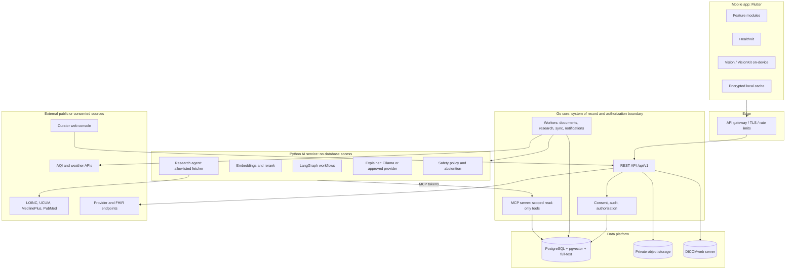

# CORTEX technical architecture, UX system and tech stack

Companion to [requirements.md](./requirements.md) and [full-architecture.md](./full-architecture.md). **In use** means it exists in this repository today. **Proposed** means a recommended choice that still needs a decision record.

The diagram and product-area table below describe the **target architecture**, not a deployment inventory. HealthKit, VisionKit, DICOMweb, provider integrations and a curator console are not implied to be shipped. For current implementation see [modules/README.md](../modules/README.md) and [data-model.md](../docs/data-model.md).

## 1. System view

**Boundaries that never change**
- Go owns identity, consent, authorization, audit and all database access.
- Python does not directly access the health database; Go supplies operation-specific data, and MCP provides separately scoped, short-lived read-only access where used.
- Only public terms leave for research. Anything involving personal data and an external model needs its own consent.
- Everything learned is stored as `pending` until a human approves it.

## 2. How each product area is built

| Area | Backend | AI / intelligence | Client |
|---|---|---|---|
| 01 Command centre | `timeline` and `goals` modules; read models over observations, documents, visits; notification scheduler | Prioritisation of "what needs attention" by deterministic rules first, model second | Today tab, timeline, goal cards, local and push notifications |
| 02 Vault | Existing upload and review flow; add OCR stage, classifier, full-text plus vector search, correction history | Document classifier (small HF model, evaluated); layout-aware extraction | VisionKit scanner, side-by-side review, versions view |
| 03 Biomarkers | Observations plus learned catalog; unit normaliser using UCUM; learned ranges per lab | Trend and change detection (statistical, explainable); frequency gaps | Flutter charts with range band, source badges |
| 04 Body observation | Encrypted image storage, region tags, comparison jobs | On-device quality checks and pose estimation first; server models only with consent | Camera capture guides, body map, side-by-side comparison |
| 05 Connected devices | HealthKit sync endpoint with idempotent upserts, device registry, source-type field | Anomaly summaries are descriptive only | HealthKit permissions per data type, sync status |
| 06 Imaging | Orthanc (DICOMweb) behind Go authorization; report-to-study links | Later, validated models only (MONAI) | Embedded OHIF viewer in a web view |
| 07 Personal AI | Existing `/questions`, MCP tools; add summary, compare and consult-prep workflows | LangGraph, hybrid retrieval, safety policy, abstention | Ask tab, cited answers, "Why this answer?" |
| 08 Research | Existing research queue; add investigations table, guideline sources, evidence grading | Evidence-quality classifier, contradiction detection across abstracts, report generation | Research tab, saved investigations, citation chips |
| 09 Lifestyle | Journal, diary and supplements tables; FHIR-aligned types | Correlation analysis with explicit "correlation not cause" labelling | Quick-add entries, daily check-in |
| 10 Environment | Worker pulls coarse-location AQI and weather; no precise location stored | Descriptive correlation only | Environment card, optional overlays on charts |
| 11 Care navigation | Visits, tasks, share links with expiry, caregiver roles | Consultation summary and question generation from approved data | Visit prep flow, share sheet, caregiver invites |
| 12 Governance | Access log, export job, deletion job covering embeddings and objects, retention policies | Agent activity history from audited tool calls | Privacy centre, consent list, activity log |

## 3. UX system

Follows Apple Human Interface Guidelines. Health content is sensitive, so calm, legible and honest beats clever.

**Navigation (five tabs)**

| Tab | Purpose |
|---|---|
| Today | Command centre: what changed, what needs attention, next follow-up |
| Records | Vault: documents, review inbox, timeline |
| Trends | Biomarkers and device data with charts |
| Ask | Personal AI and research investigations |
| Me | Profile, goals, care, privacy centre |

Capture is a persistent "+" action (scan, upload, add reading, log symptom, take photo) available from every tab.

**Design rules**
1. One primary action per screen.
2. Every number shows unit, date and source type (lab, device, self-entered) one tap away.
3. Uncertainty is a normal state with a designed treatment (muted badge, plain text, next step), not an error.
4. Safety guidance is calm. Alarm colours are reserved for genuinely urgent guidance.
5. AI-written text is always labelled, with a toggle to show only recorded facts.
6. Reviewing is fast: uncertain items first, confident ones batched.
7. Empty, loading, offline and failure states are designed for every screen.

**Standards**
- **Accessibility:** Dynamic Type to the largest sizes, VoiceOver labels on every chart point and badge, reduced motion, colour-blind safe palette, minimum 44pt targets, WCAG AA contrast. Charts expose a data-table alternative.
- **Design tokens:** colour, type scale, spacing and radius defined once and shared; light and dark themes.
- **Localisation:** string catalogs, locale-aware units, dates and number formats from day one.
- **Privacy UX:** biometric lock, hidden content in the app switcher, per-feature consent screens in plain language, "what left my device" log.
- **Quality bar:** snapshot tests for components, UI tests for capture → review → ask, accessibility audits in CI.

## 4. Data model highlights

- `observations` carry `source_type` (`lab`, `device`, `self`), `source_id`, unit, UCUM code, verification status.
- Everything clinical can be mapped to **FHIR R4** resources (Observation, DocumentReference, MedicationStatement, Condition, DiagnosticReport, ImagingStudy) for import, export and provider exchange.
- `timeline_events` is a read model fed from all sources, so the command centre stays fast.
- Provenance and audit tables are append-only.
- Embeddings store model name and revision; re-indexing is automatic when either changes.

## 5. Tech stack

### In use today

| Layer | Technology |
|---|---|
| Mobile | Flutter, Dart |
| API and workers | Go 1.2x, chi router, pgx |
| Database | PostgreSQL with pgvector (HNSW) and full-text (GIN) |
| Object storage | SeaweedFS (S3-compatible) |
| AI service | Python 3.12, FastAPI, LangGraph, httpx |
| Embeddings | Hugging Face `BAAI/bge-small-en-v1.5` (pinned revision, 384-d), sentence-transformers, PyTorch CPU |
| Local LLM | Ollama (`qwen2.5:1.5b`) behind a safety policy |
| Agent tool protocol | MCP (JSON-RPC) with HMAC-signed scoped tokens |
| Open standards | LOINC, UCUM, NIH Clinical Tables, MedlinePlus, PubMed E-utilities |
| Packaging | Docker, Docker Compose |
| Testing | Go `testing`, pytest, DB-backed tests via `TEST_DATABASE_URL` |

### Proposed additions

| Need | Recommendation | Why |
|---|---|---|
| Identity | OIDC with Sign in with Apple, plus a self-hosted provider (Keycloak or Ory) for admin and web | Replaces dev-token sessions; standard and auditable |
| Job queue | River (Go, Postgres-backed) or a transactional outbox | Durable retries without new infrastructure |
| OCR | Evaluate existing Tesseract pipeline and alternatives | Improve accuracy while preserving review and privacy |
| Document classification | Small Hugging Face classifier, evaluated and pinned | Cheap, auditable |
| Charts | Extend existing Flutter charts | Consistent cross-platform, accessible visualization |
| Health data | HealthKit, Apple Health Records (FHIR) | Standard device and record source |
| Imaging | Orthanc (DICOMweb), OHIF viewer; MONAI later | Open standard stack |
| Terminologies | LOINC, UCUM now; RxNorm and ATC for medicines; ICD-10 and SNOMED CT (licence review) | Learned and reviewed, never shipped |
| Environment data | Open-Meteo, OpenAQ (public APIs) | Coarse location only |
| Push | APNs | Reminders and follow-ups |
| Admin console | Small web app (Next.js or Go templates) | Curator inbox, review, audit search |
| Search | PostgreSQL first; add OpenSearch only if needed | Avoid early complexity |
| Observability | OpenTelemetry, Prometheus, Grafana, Loki, Tempo | Traces across API, worker, AI, tools |
| Secrets and keys | Cloud KMS or Vault; field-level encryption for sensitive columns | Key rotation and revocation |
| Security | Dependabot, `govulncheck`, `pip-audit`, container scanning, SAST | Automated in CI |
| CI/CD | GitHub Actions with a Postgres service, image builds, SBOM | Reproducible verification |
| Infrastructure | Terraform; Kubernetes once more than one host is needed | Repeatable environments |
| Mobile quality | XCTest, XCUITest, snapshot tests, Accessibility Inspector | Matches the UX standards above |
| Evaluation | Versioned eval sets for extraction, retrieval and answer safety; a regression gate in CI | Required before promoting any model |

## 6. Compliance and safety posture

- Position as a records organiser and explainer, not a medical device, and keep claims consistent across UI, marketing and answers. Revisit with legal review before adding imaging AI or any diagnostic-style feature.
- Plan for GDPR-style rights (access, export, deletion) and applicable local law such as HIPAA or India's DPDP Act, depending on where users are.
- Imaging, body observation and device ECG each need their own clinical and regulatory review before inference is enabled.

## 7. Delivery order (summary)

1. Validate existing document, summary, identity and governance flows end to end.
2. Design and implement user-confirmed concern grouping and source-aware cross-feature views.
3. Evaluate evidence, explainers and analytics with clinical and privacy review.
4. Scope external health integrations and medical imaging separately.

Detailed checklists are in [milestones.md](./milestones.md).
