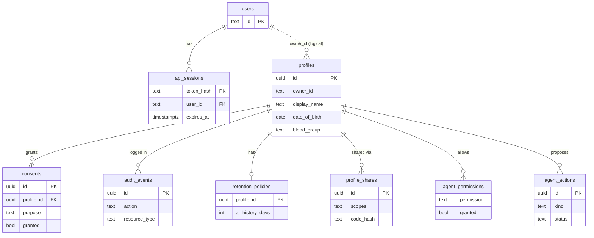
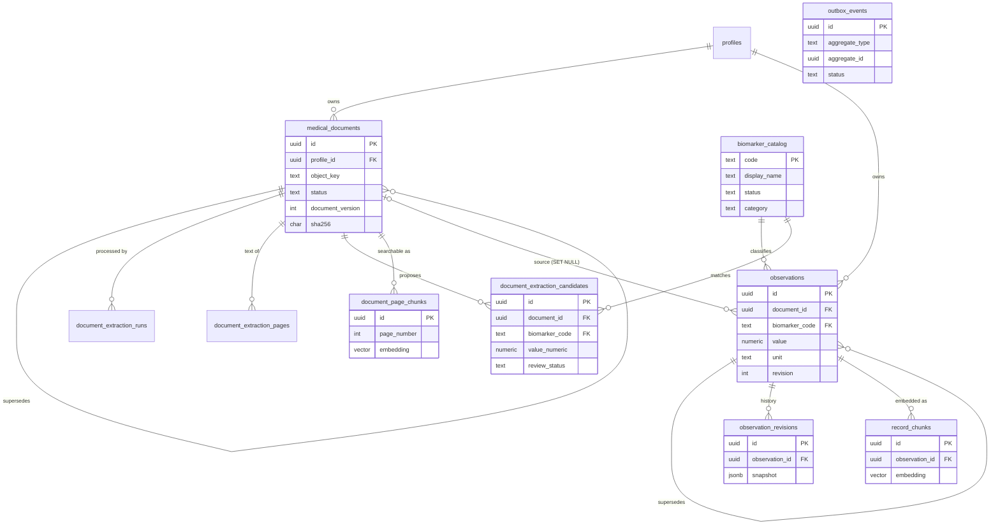
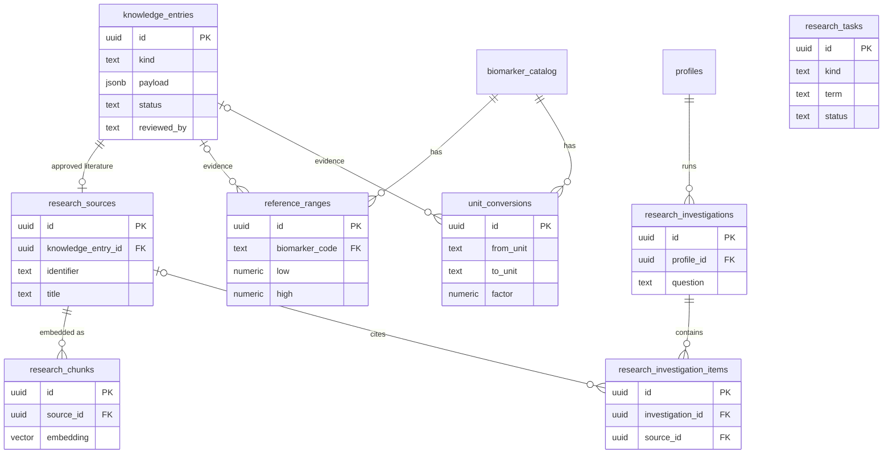
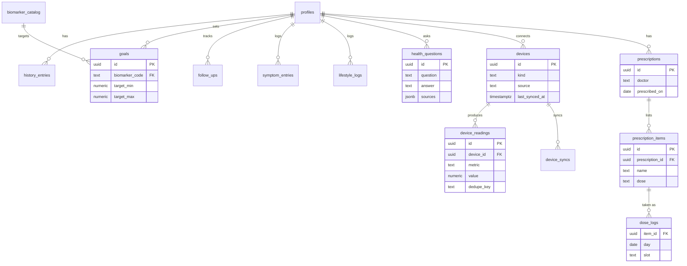

# CORTEX data model

Derived from [`backend/internal/store/migrations/`](../backend/internal/store/migrations/) (001–023). Key columns only.

**Ownership rule:** `profiles` is the root of all personal health data. Child tables carry `(profile_id, owner_id)` with a composite FK to `profiles(id, owner_id)` (cascade delete), so a row can never point at a profile owned by someone else. `owner_id` is the identity string from `users.id`; it is a logical link, not a foreign key.

## 1. Identity, consent and audit

## 2. Documents, extraction and observations (the core record)

`outbox_events` is the durable queue for document processing. It references documents by `aggregate_id` (no FK).

## 3. Learned knowledge and research

`research_tasks` is a standalone queue; results land in `knowledge_entries` as `pending` until an administrator approves them.

## 4. Health tracking, devices, medications and questions

`history_entries`, `follow_ups`, `symptom_entries` and `lifestyle_logs` have no links beyond the profile.
